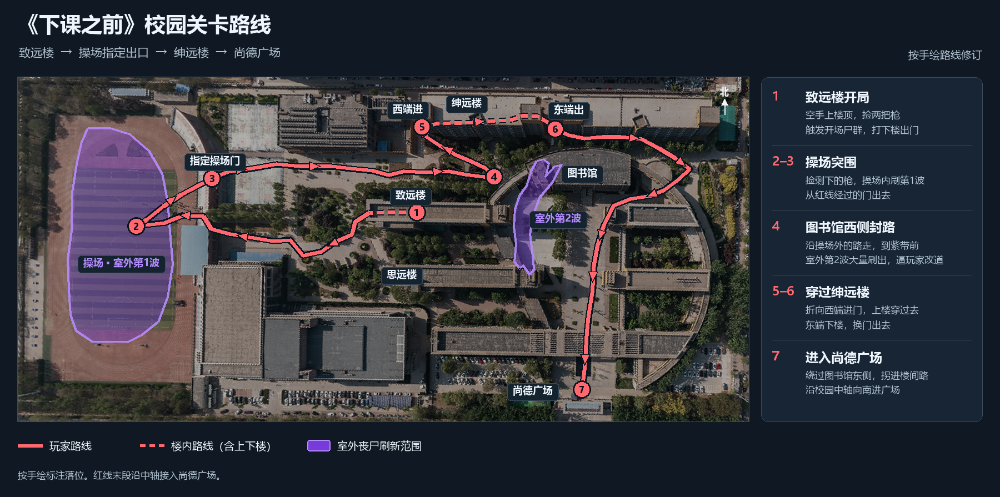

# 下课之前丧尸枪战玩法方案

玩家在致远楼教室空手开局，上楼顶拿枪，打下楼后去操场补给。校园沿途会持续刷普通丧尸，操场和尚德广场入口各有一场大尸潮。广场前仍允许玩家硬闯，但尸群规模远超沿途能拿到的子弹，主要路线是穿过绅远楼再绕进广场。

红线是玩家路线。紫色标出操场和图书馆西侧的两场大尸潮。绅远楼内的虚线包含上楼和下楼，楼层走法见下文。

## 关卡流程

| 阶段 | 玩家怎么走 | 丧尸何时出现 |
| --- | --- | --- |
| 致远楼 | 教室出生时没有武器。按提示上楼顶，捡枪后沿楼梯打到首层，出楼去操场。 | 拾取第一把楼顶武器时触发开场战斗，首轮试配30只，在楼梯和下楼经过的楼层分批出现。 |
| 操场 | 拿剩下的枪和较多的子弹，从路线图标注的操场门突围。 | 首次拾取操场武器或弹药时，操场紫色范围开始刷第一场室外大尸潮，首轮试配120只。玩家冲到门口就能出去。 |
| 广场前 | 出操场后沿红线走，接近图书馆西侧通往尚德广场的路。可尝试硬闯，也可折向绅远楼西端门。 | 第一次接近尚德广场时触发第二场室外大尸潮，首轮试配420只。常规丧尸沿途照常刷新。 |
| 绅远楼 | 从西端进门，关门挡住楼外追来的丧尸。上楼补一小份弹药，沿楼道慢慢推进，到东端下楼，从另一扇门出去。 | 楼内按常规算法分段补怪。楼梯转角、平台和前方楼道逐段出现敌人。 |
| 尚德广场 | 从绅远楼东端出去，绕图书馆东侧，拐入楼间路，沿校园中轴向南进广场。 | 沿途继续刷普通丧尸。已经触发的广场尸潮沿用原进度。 |

## 广场尸潮与提前到达

第一次接近尚德广场时，显示提示「前面全是丧尸。你可以试着突围，也可以从绅远楼绕过去。」直路保持可走，尸群占住通道。走到这里之前，玩家最多从楼顶和操场捡到132发，广场尸潮的420只约为这个数的3.2倍。前排倒下后，玩家能看见后面仍有大批丧尸涌来。420只按整场累计生成，同屏数量按实机性能调节。

图书馆西侧和其他直接进入尚德广场的路口共用同一个触发事件。玩家绕开操场先到广场，也会立即刷出首批丧尸，任务仍提示「去操场取剩余武器」。如果玩家退回操场拿枪再回来，广场接着刷剩余批次，已拾取的补给保留原状态。

## 绅远楼关门与楼内推进

首轮先试「西端进首层 → 西梯上二层 → 二层平台补弹 → 沿二层楼道往东 → 东梯回首层 → 东端门出」。把弹药放在上楼后能看见的平台边，玩家经过楼梯就能拿到。离开楼道后沿图书馆东侧绕回尚德广场。

玩家关上西端门后，门扇碰撞和门槛导航同时关闭通路。楼外追来的丧尸在门外停住，可以拍门，安静一段时间后逐渐散开。重新开门后，门外还有丧尸就能继续追进来。楼内丧尸独立计算，关门给玩家腾出推进的时间。

常规刷新沿用[丧尸算法](丧尸算法.md)的首轮参数。每2.2秒检查一次，每批最多2只，普通丧尸同时最多8只，玩家19米内已有5只时暂停补怪。生成点在离玩家7.5至24米的可达位置，检查视野和身体净空。宿舍优先从当前楼层的前方转角或经楼梯可达的平台选点，隔着楼板的上下层按实际路径判断距离。丧尸发现玩家后追击，失去目标后到最后一次看见玩家的位置搜索。两场室外大尸潮使用各自的生成预算，普通丧尸的8只上限只管沿途和楼内的常规刷新。

## 武器与弹药试配

以下数量按单人首轮试玩配置，包含枪内已有的子弹。每份补给一局只领取一次。

| 补给点 | 新增武器与弹药 | 新增子弹 |
| --- | --- | ---: |
| 致远楼楼顶 | 两把枪。手枪12发，轻型步枪24发。 | 36发 |
| 操场 | 两把枪。冲锋枪36发，霰弹枪12发。另补手枪24发、轻型步枪24发。 | 96发 |
| 绅远楼二层西梯平台 | 补手枪12发、轻型步枪12发。 | 24发 |
| 合计 | 四把枪，三处补给。 | **156发** |

## 首轮试玩核对

- **走正常路线。** 楼顶拿枪后能打下楼，操场拿到补给就刷尸潮，玩家能从指定门突围。两场室外大尸潮之间仍有普通丧尸。
- **跳过操场先去广场。** 第一次走进任一路口的接近区就刷广场尸潮。退回拿枪后再来，沿用本局已经出现的尸群和剩余批次。
- **尝试在广场前硬打。** 测满补给时能坚持多久，尤其检查霰弹一次击中多只时，玩家能否靠清场直接通过。选择宿舍绕行后，能关门挡住楼外丧尸，在二层拿到少量弹药，沿楼梯和楼道打到东端门。
