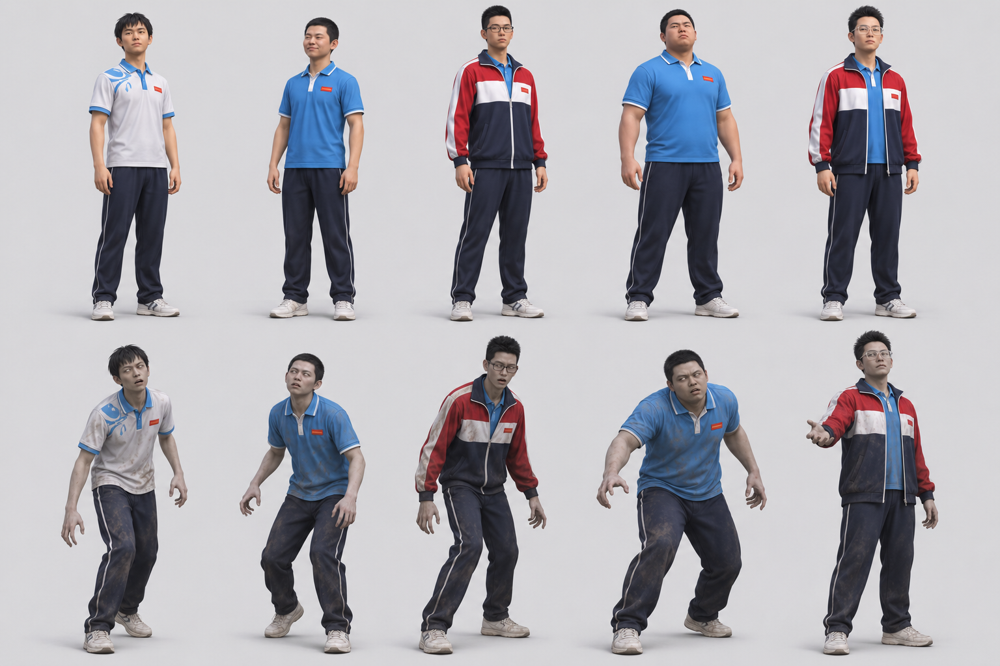

# 下课之前丧尸算法

本文是首关的实现规格。玩法以[玩法方案](../下课之前_玩法方案.md)为准。先用两间教室、一段走廊、一个楼梯口验证，再接入致远楼和室外路线。普通丧尸靠近距离视线和局部声响找到人。它们会失去目标，也会在锁上的门外先聚后散。

## 整校单人版

从 OpenFire 主菜单选择「下课之前 · 校园逃生」。游戏加载现有的整校模型和碰撞，从致远楼二层教室开始。致远楼东西楼梯沿用实走核对过的梯段与平台点位。正门和西门分别结算。西门的撤离点设在现有绿色栏门内侧。AI 同学保持人类形态，玩家转化后仍可追逐它，咬击只会让它短暂踉跄。

| 首轮刷怪参数 | 取值 |
| --- | --- |
| 玩家周围的生成距离 | 7.5–24 米 |
| 全局普通丧尸上限 | 8 只 |
| 玩家近区的补怪门槛 | 19 米内有 5 只时暂停补怪 |
| 刷怪检查间隔与批量 | 每 2.2 秒检查一次，每批最多 2 只 |
| 远处回收 | 游荡、搜索或散去状态下，连续 10 秒离玩家至少 33 米 |

生成点以玩家位置为中心抽样，投影到现有校园的导航网格，再检查脚下地面、身体净空、可达路径和玩家视野。靠近西楼梯时优先在首层门厅一带补怪，仍受上述距离、视野和数量约束。教室门关上即断开对应导航连接，开到可通行时恢复。

当前游戏入口为单人。联机房间内的丧尸、楼门与结算同步仍按后续验收项推进。

## 开源项目对照

| 项目 | 源码里的做法 | 校园版取舍 |
| --- | --- | --- |
| [Zombie Zone](https://github.com/zees-games/game-zombie-zone) | [普通丧尸逻辑](https://github.com/zees-games/game-zombie-zone/blob/19e65c404db70a318c698a2ae419ae9d426921e1/npcs/zz_common_brain.gd)区分看见人后追击与只听见声音后调查。不同个体分开警觉，接近同一幸存者的攻击者受限。使用自己的[导航图](https://github.com/zees-games/game-zombie-zone/blob/19e65c404db70a318c698a2ae419ae9d426921e1/game/zz_nav_graph.gd)，对单向下落等连接做过滤。 | 参考错峰反应、调查声源和围堵节奏。校园首版以楼梯和门为跨区通道，采用 Godot 原生三维导航。上游 README 将多层楼梯地图列为待补项，先用自有小关卡验证。代码许可见 [MIT 原文](https://github.com/zees-games/game-zombie-zone/blob/19e65c404db70a318c698a2ae419ae9d426921e1/LICENSE)。 |
| [Murder Floor](https://github.com/cesko/godot_fps_test) | [角色脚本](https://github.com/cesko/godot_fps_test/blob/bffb9940f1bd4a962d2cc8181719f7a3c65e2b31/src/characters/zombie.gd)持续把目标世界坐标交给 `NavigationAgent3D`。[移动状态](https://github.com/cesko/godot_fps_test/blob/bffb9940f1bd4a962d2cc8181719f7a3c65e2b31/scenes/characters/zombie_state_machine/moving.gd)跟随下一个路径点，进入攻击距离后切换状态。 | 参考状态与路径跟随的分工。校园版追丢后只追最后目击点，卡住后换站位或重新规划。代码许可见 [MIT 原文](https://github.com/cesko/godot_fps_test/blob/bffb9940f1bd4a962d2cc8181719f7a3c65e2b31/LICENSE)。 |
| [Nazi Zombies Portable](https://docs.nzp.gay/landing/) | 使用人工设[路点](https://docs.nzp.gay/mapping/waypointing)，目标不可达时可前往[集结点](https://docs.nzp.gay/mapping/zombie-horde-points)。 | 只借鉴门口候位和区域集结点的布置思路。墙、楼梯及路线仍由校园导航网格处理。 |

## 个体状态和感知

| 状态 | 采用的信息 | 转移条件 |
| --- | --- | --- |
| 游荡 | 局部巡游点 | 看见人就追击，听到有效声音就调查 |
| 调查 | 有时效的声源位置 | 到达后短时搜索，直接看见人则转追击 |
| 追击 | 可见目标和最近一次目击点 | 失去视线后走到目击点，遇到刚看见目标通过并关上的门时尝试占用门前站位 |
| 拍门 | 已知封闭的门与站位 | 门打开后重新判断视线，安静且等待到期后散去 |
| 搜索 | 目击点或声源附近的可达位置 | 找回目标或听到有效新声响时改变目标，否则超时散去 |
| 散去 | 所在区域的巡游点 | 分批离开门口并恢复游荡，直接目击仍能重新进入追击 |
| 咬击与眩晕 | 近距候选目标、攻击时点或道具事件 | 进入咬击前摇后在命中时点核对距离、朝向和遮挡，眩晕可中断前摇 |

视觉检测先按距离和夹角筛选，再从头部向躯干做遮挡检测。检测按错开的间隔更新。追丢后保存的是上一次确认的位置和时间，搜索期间只检查当前视野和新声源。普通丧尸各自保留感知记忆，附近同伴被惊动时只收到动静的大致位置。

声响用独立的玩法事件记录 `类型、位置、区域、强度、发生时间、来源ID`。静步的脚步强度为零，走路低，跑步高。开关门、扔书落地、撞动桌椅另外发事件。声音在教室、走廊、楼梯段和室外之间经门窗连接传播。首版用带权区域图和有上限的 Dijkstra 扩散。边权包含传播距离与门窗阻隔的衰减，剩余强度不足时停止扩散。窗外扔书按实际落点所属区域发声。直接目击优先于声源，普通丧尸追着看得见的人时继续追。

## 楼梯与关门寻路

Godot 的 [NavigationAgent3D](https://docs.godotengine.org/en/stable/classes/class_navigationagent3d.html)负责路径跟随，默认路径查询使用 [A*](https://docs.godotengine.org/en/stable/classes/class_navigationpathqueryparameters3d.html)。从简化地面、门槛和楼梯碰撞烘焙 NavMesh。每层通过实际可通的楼梯相连，窗户作为声学开口使用。

门口留出导航网格间隙，让 [NavigationLink3D](https://docs.godotengine.org/en/stable/classes/class_navigationlink3d.html)成为跨门槛的通路。门实际打开到可通行时才启用连接，关闭时禁用。碰撞与导航用同一个门状态，而且关闭后要检查两边网格没有自动连边。门状态、目标跨区域、追击目标明显移动或原路失效时请求重算，同一帧给路径查询设预算。稳定跟随期间按物理帧取下一个路径点。

碰到关门且没新的目击信息时，按门外可达站位安排拍门或搜索。每扇门只分配少数拍门位置，后到者在外侧等候。相同门的一轮拍门只产生一次用于吸引周围丧尸的聚集事件，后来的敲门继续播放声音，但沿用这轮事件编号。安静持续一段时间后按个体等待时长依次散回巡游点。新的玩家噪声或目击可以打断散去。丧尸距离判断要用不同楼层的路径和区域，避免贴着楼板追错层。

首轮试玩可先把每个目标的同时咬击名额设为一个。占位者完成咬击、开始眩晕、失去目标或超过等待时限时释放名额，附近其他丧尸继续跟随或候位。这样能单独调试咬击前摇和胶布体验，再决定尸群密度。

## 咬伤、僵尸王与联机

- 首个有效咬击在有护臂耐久时消耗胶布并触发踉跄。无耐久的咬击只开启一次转化倒计时，首轮以约45秒试玩。砖头和高壮能力造成短时眩晕，咬击应在起手后结算，同时验证遮挡与距离。
- 玩家转化时沿用角色的外观编号和校服，用感染材质、僵尸动作和新的输入规则。僵尸王速度高于普通丧尸、低于人类冲刺，视野依然近且窄。按玩家标记的可达点，从近处仍在游荡或搜索的丧尸中选两三只前往。标记失效、抵达并搜完或重新看见幸存者时退出指令。预留冷却及每名僵尸王的随从上限。
- 单人由本机执行同一套规则。联机由主机判定声响、门状态、咬击、转化和指挥命令。连续移动用快照同步，门变化、角色转化和指令结果按事件同步。主机为咬击事件分配编号，重复事件只结算一次。

## 验证场景

| 操作 | 预期结果 |
| --- | --- |
| 同一位置静步、走路、跑步，分别经过挡住视线的走廊转角 | 静步无脚步声事件，走路和跑步的有效听觉范围有差别。进入清晰视线后，三种移动都可能被发现。 |
| 从窗边扔书，同时一只丧尸正追玩家 | 游荡者去室外落点调查，追击者继续追可见目标。 |
| 丧尸看见玩家进屋，随后门关闭 | 取消跨门路径，丧尸停在门外，先聚后散。开门后从真实门洞通过，楼上楼下按实际楼梯寻路。 |
| 两名玩家站在门两侧，分别观察锁门和咬击 | 两边看到相同门状态，咬击与胶布消耗只结算一次。转化后新角色继续沿用原衣服和外观编号。 |
| 僵尸王标记可达点及锁门后的不可达点 | 可达点触发小队调查，失效或不可达的指令有明确反馈。直接目击人类优先。 |

## 人物和感染形象

校服沿用首批照片中的蓝白短袖、白底蓝领短袖和红白藏蓝运动服。新参考用于短发、脸部轮廓、眼镜和体态。设定图按从左到右安排短直刘海普通同学、短寸普通同学、深框眼镜高瘦、短寸高壮、浅色方框眼镜的带路同学。下排为对应的感染形态，最后一列示范僵尸王的指挥姿态，玩法里的转化资格与外观编号无关。



参考 [Quaternius Zombie Apocalypse Kit](https://quaternius.com/packs/zombieapocalypsekit.html) 的共用骨架和动画复用方法，以及 [Zombie Zone 的蹒跚动作](https://github.com/zees-games/game-zombie-zone/blob/19e65c404db70a318c698a2ae419ae9d426921e1/npcs/zz_zombie_view.gd) 用低头、单侧拖步和步幅变化区分轮廓。原角色的眼镜、发型和校服在转化后仍可识别。感染表现用灰冷肤色、雾灰眼睛、轻污渍和身体姿态。普通丧尸用垂肩和不对称步态，僵尸王靠更直的站姿和明显的指挥动作区分。

<details>
<summary>设定图生成提示</summary>

使用内置 ImageGen。输入依次为本轮的图2、图3、图4、图5和图8。

```text
Create a new professional 3D game character concept comparison sheet using the attached user photographs as references for stylized character faces, hair, glasses and silhouettes only. Wide landscape 3:2, on a solid very light neutral gray, FIVE equally spaced columns and TWO rows, exactly ten full-body figures. Top row healthy, bottom row matching mild fictional zombie variants. Everyday East Asian young-adult game characters, medium-poly stylized game 3D rendering, clear facial shapes, believable trackwear, same eye-level front three-quarter viewing angle and neutral studio light for all, hands unobstructed, head and shoes intact and visible. From left to right, keep exactly this order: (1) ordinary student with short slightly jagged straight fringe like reference 1, no glasses, wears white polo with bright sky-blue slim collar piping, sky-blue placket and blue shoulder graphic. (2) ordinary short cropped hair student, no glasses, rounder face inspired by the left seated student of reference 2, wears sky-blue polo with white placket and trim. (3) taller slim jogger, short upright black hair, dark thin rectangular glasses inspired by the middle seated student of reference 2 and the profile in reference 5; wears the navy-red-white zip track jacket with blue polo underneath. (4) broad and sturdy athletic build inspired by the central foreground athlete in reference 3, black buzz cut and no glasses, wears sky-blue polo and navy track trousers. (5) classmate guide with upright short hair and clear pale square glasses inspired by reference 4 and the right seated student of reference 2, distinguish clear glasses from dark glasses of column 3; wears open red-white-navy track jacket over blue polo. Use the broad white chest band, red upper shoulders and sleeves, deep navy lower body, white front zipper on the track jacket. All trousers deep navy with thin side piping and ordinary sneakers, and small generic red rectangle chest detail, no readable logo lettering. Maintain same hair, facial geometry, body size, outfit and glasses in both rows. Bottom row for columns 1–4: mild cool gray skin, more opaque gray eyes, disheveled but fully intact clothing, subtle dry dirt, one shoulder dropped, irregular stagger-ready poses. Bottom row at column 5: example of controllable zombie leader, still gray-eyed and wearing the same clothes, slightly more upright with one low open-hand directional gesture. Full coverage school sports uniforms in every cell. No blood, injuries or gore. No labels, captions, screenshots, posters, real photo backgrounds, text, interface or extra people.
```

</details>
